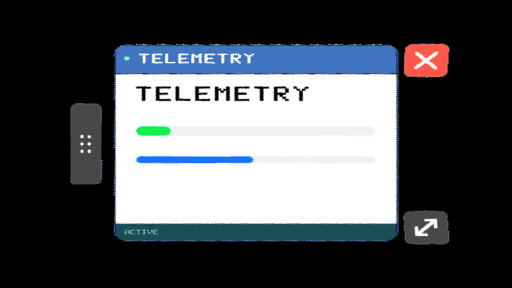

# v12 SD 실보드 콜드 부팅 확인 — 2026-11-15

사용자가 새 SD를 기록하고 전원을 켠 뒤, 기존 L1 16KiB·DMA3 비트스트림을 JTAG으로 올렸다. 설정 완료 1, CRC 오류 0을 확인했다.

- SD에서 Linux `6.12.0-haebancheon-mask12`와 BusyBox 쉘 부팅 확인. 비트스트림 업로드 종료부터 첫 쉘 프롬프트까지 약 126.7초.
- `/etc/oryukdo-image`: `HAEBANCHEON-BoAYO-mask-v12`.
- `/data` ext4 읽기·쓰기 마운트 확인. 이번 부팅에서는 별도 파일 쓰기·읽기 시험을 반복하지 않았다.
- SD에 포함된 `/usr/bin/boayo-native`를 직접 실행했다. 실행 파일을 PC에서 RAM으로 업로드하지 않았다.
- BoAYO 계획 버전은 최종 v12의 `8f5db34197f157cd8404ab166ed0d9b03742f01656ced910d17d3059a96f9be6`과 일치. 앱/렌더 오류 없음, DMA 오류·타임아웃 0, 실제 하드웨어 출력 완료 확인.
- HDMI 재연결만으로는 캡처 영상이 복구되지 않았고, 사용자가 캡처카드의 USB를 재연결한 뒤 캡처를 다시 열자 실제 Telemetry 화면을 확인했다. 이 과정에서 FPGA와 BoAYO 데몬은 재시작하지 않았다. 정확한 신호 재인식 실패 원인을 규명한 결과는 아니다.
- 현재 UART·HDMI 실시간 창과 Telemetry를 실행 상태로 유지했다. 이전 25단계 조작 검증은 [BOARD_RESULT_KO.md](BOARD_RESULT_KO.md)에 있으며 이번 부팅에서 전부 재실행한 것은 아니다.

이 기록으로 이전 문서의 ‘새 SD 전체 실보드 콜드 부팅 미확인’ 상태를 갱신한다. 원시 로그와 캡처는 [콜드 부팅 증거](evidence/coldboot-20261115/result.json)에 있다.

