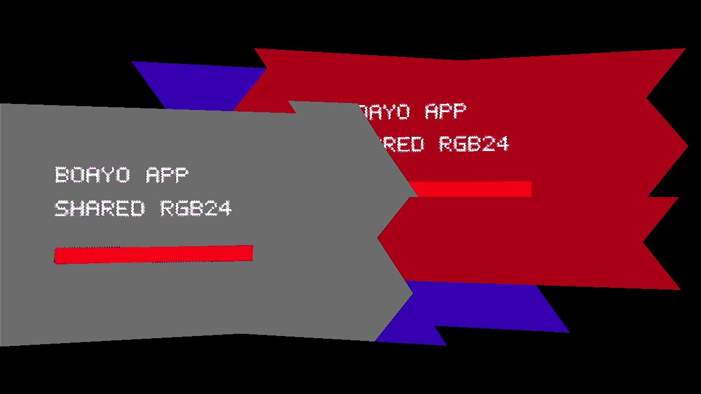

# BoAYO calling model: physical-board results

This is the preserved pre-optimization baseline. See [OPTIMIZATION_RESULTS.md](OPTIMIZATION_RESULTS.md) for the subsequent CPU planning and RGB332/RGB32 buffer comparison.

Date: 2026-11-20. PZ-A7200T-KFB, RV32IMA design at 50 MHz, existing Linux/BOSIO ABI 3 image. The service, test application, UART logs, and HDMI recording were exercised on the physical board. FPGA logic and the SD boot installation were not changed.

**Functional result:** the independent triangle WM accepts the BoAYO application protocol. The already installed, unmodified `boayo bench-small 5` executable successfully created a window, mapped its RGB24 shared surface, submitted damage, and waited for presentation. The new application uses the existing C++ `Client` unchanged. Internal move, angular resize, stacking, close, and view pose operations work without GUI buttons.

**Performance result:** isolated small damage stays below one second in this sample, but content movement and resizing do not. The earlier solid-window timing does not establish a one-second bound for these operations. Initial application content also takes about three seconds through the complete application calling path.

## Application-to-presentation latency

These values include the C++ Client request/response processing, the application copy into the shared slot for content updates, the WM snapshot/render, and the `wait_present` round trip. They exclude generating the application's source image and exclude optical/capture delay. UART printing and transfer are outside the timed interval.

| Operation | N | Median ms | P95 ms | Maximum ms |
|---|---:|---:|---:|---:|
| Initial 240×144 content | 1 | 3104.188 | 3104.188 | 3104.188 |
| 8×8 partial content | 11 | 555.351 | 784.423 | 784.423 |
| Move a content window | 7 | 1684.559 | 1762.325 | 1762.325 |
| Resize a content window | 7 | 1908.930 | 1928.285 | 1928.285 |
| Restore original position/size | 1 | 1715.042 | 1715.042 | 1715.042 |
| Initial content in second window | 1 | 2891.630 | 2891.630 | 2891.630 |
| Initial content in third window | 1 | 3094.758 | 3094.758 | 3094.758 |
| Move with three overlapping content windows | 5 | 2035.956 | 2044.989 | 2044.989 |
| Raise a window | 1 | 961.473 | 961.473 | 961.473 |
| Close an overlapping window | 2 | 592.683 | 711.944 | 711.944 |
| Output view pose through Client | 7 | 234.246 | 249.914 | 249.914 |
| Application destroys its own window | 1 | 491.488 | 491.488 | 491.488 |

The two close samples are 473.421 and 711.944 ms. Small N values are descriptive checks, not distribution estimates. First create/map/application image preparation took 1736.145 ms separately from initial content submission.

The unmodified installed BoAYO benchmark reported:

| Damage | N | Median ms | P95 ms |
|---|---:|---:|---:|
| 1×1 | 5 | 533.585 | 538.641 |
| 8×8 | 5 | 554.736 | 563.201 |

Its pre-existing 300 ms target was **not met**. The new benchmark covers up to three content windows; the earlier six-stage experiment's 32-solid-window and eight-content-window results remain separate workloads.

## Where the time goes

- Initial content: commit acceptance is 1571.900 ms, followed by rendering/presentation. The renderer itself takes 1474.803 ms, including 264.078 ms in the texture upload/projection portion and 120.589 ms in publication. The acceptance interval includes client RGB32→RGB24 packing, IPC, the private RGB24 snapshot, RGB24→RGB32 conversion, and response processing; these have not been individually profiled.
- An 8×8 edit snapshots 192 RGB24 bytes, uploads 7680 bytes of full-width RGB32 rows, and reprojects four tiles instead of the initial 40. The first update copies 36 unchanged tiles to the other bank and accounts for the 784.423 ms maximum. Later updates reuse those bank contents.
- Content movement has median renderer time 1284.660 ms, projection portion 111.205 ms, and publication 130.419 ms. No texture upload is needed in the single-window move/resize cases. The remaining renderer time includes CPU descriptor regeneration and scene planning; reducing DMA fill time alone cannot remove it.
- Angular resizing has median renderer time 1484.632 ms and reprojects about 60 tiles in this workload. It keeps the same 240×144 source mapping.
- Three-window movement can upload 276480 bytes because the device currently caches one source texture. Its median projection/upload portion is 450.972 ms.
- The service is serial. During a later live-demo update, concurrently starting a status CLI produced a 1330.840 ms text update. The isolated partial-update measurements are not a bound under additional CPU/IPC load.

The earlier raw C-client experiment excluded request serialization and did not use this two-RPC shared-surface calling path. Its latency numbers therefore have a different measurement scope.

## Output pose and visual checks

A 61-pose trajectory had median output submission/acknowledgement 45.086 ms, P95 45.236 ms, and maximum 45.272 ms. Precomputation took 1665.161 ms separately; the loop also adds pacing. This is not a 60 FPS interaction result. Pose changes did not trigger scene recomposition.

Actual HDMI frames show the borderless triangle silhouette, partial content changes, moved/resized content, three overlapping windows, restoration after close, and a completely black frame after the final window closes. The capture was reopened during service transition verification; the original recording also contains the installed BoAYO client's distinct test image. A fresh recording covers the new application benchmark.

The live demo runs a changing text counter inside one application window. Monitor: `http://127.0.0.1:8766/`. Capture is 1280×720, nominally 60 samples/s; AVI uses a 30 FPS playback hint. Use the host capture timeline for elapsed time, not AVI playback duration. Host capture and target clocks are not synchronized.

## Validation and evidence

- Host API regression passed, including full-scene versus incremental tile-hash comparisons, ownership, immutable commit snapshots, malformed damage atomicity, stale sequences, no-op commits, resize, overlap, disconnect cleanup, and pose-only updates.
- The same API regression passed with AddressSanitizer and UndefinedBehaviorSanitizer. Startup checks cover preserving an existing regular file, refusing a live socket, and recovering a dead socket.
- Original solid/content regression suites passed. Camera comparison passed 1196 poses with maximum error one Q24 unit.
- Physical benchmark completed all 45 samples and the 61-pose sweep with no request failure. Driver status remained in real-device mode; both projection cores accumulated completion interrupts.
- [Measurements and raw sample payloads](results/boayo-board-20261120.json), [build manifest](results/boayo-build-manifest.json), [installed-client HDMI frame](results/boayo-legacy-client.jpg), [closed-scene frame](results/boayo-closed.jpg).
- Local raw UART evidence: `evidence/TRI_d2b4fc0613.log`, `evidence/TRI_6c0f5dc162.log`, and live status/contended update `evidence/TRI_6cd47c4b75.log`. Local recordings: `evidence/boayo-legacy-bench.avi` and `evidence/boayo-application-benchmark.avi`.

The main benchmark used service SHA-256 `eb1fb6500b451d27e1aab3bd6c4e88d147ef8a836af8c853a472f0946e8705ad` and application SHA-256 `0e6f51a66cd4ff7400e219211754449a434a027316cbac0a8a0311574a8a3787`. The final service adds startup socket/file checks and a response-queue bound; renderer and application code are unchanged. Its final build and live smoke result are recorded in the manifest. Deployment remains under `/tmp`, with no boot-time replacement.

Final service SHA-256: `e5577aeb0b85735733bcd271df49473f11073d96dc90fbedbfea65c7db3d4d97`. After verified deployment and restart, the live demo submitted initial content in 2999.404 ms and subsequent counter updates in 817.277 and 631.795 ms. The HDMI counter continued advancing. See [the final live frame](results/boayo-live.jpg) and `evidence/TRI_0ec857f8b1.log`. Service PID 254 and application PID 256 were left running at completion.
