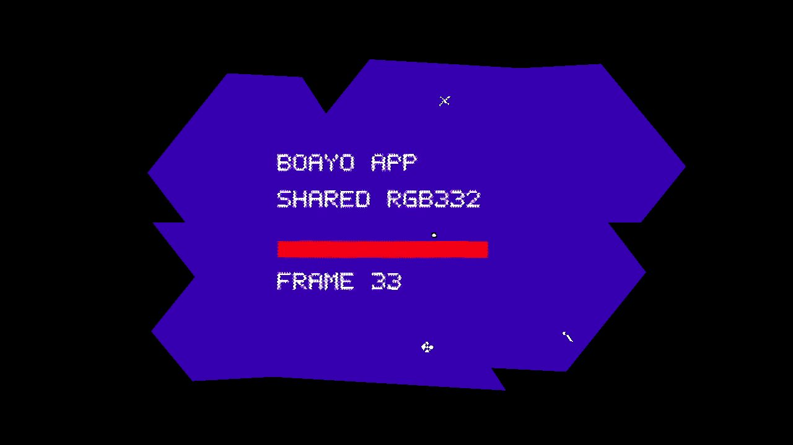

# Latest-content coalescing (v11)

The WM combines pending damage per window and renders the latest accepted pixels in those regions. Applications keep the existing BoAYO calls and shared-slot lease contract.

## Acceptance and publication

1. Validate every damage rectangle and the strictly increasing surface sequence before changing state.
2. Snapshot the declared bytes and copy changed bytes into a WM-owned packed source image. The commit reply releases the app slot; reusing that slot cannot alter the queued image.
3. Merge pending damage. Overlapping rectangles combine; disjoint regions stay separate up to 128 entries, after which a conservative bounding rectangle bounds storage. Undeclared gaps keep their prior accepted pixels or initialized background.
4. Immediately before rendering, convert only accumulated regions from the latest source. Invalidate each affected tile once, then project/upload the current image. Repeated intermediate pixel values are not converted or projected individually.

`changed` compares against the latest accepted source, including pending updates. A repeated no-op consumes its sequence without a new generation. `wait_present(generation)` acknowledges a publication at least as new as that generation; it does not promise every intermediate image was displayed. Click/drag operations are still processed individually in connection order.

The event loop performs up to four nonblocking I/O sweeps before publication: at most 32 requests total and four per peer per sweep. Ready control peers are visited first, and application peers rotate. No debounce sleep is added. The request bound prevents a continuous producer from indefinitely postponing publication; it is not a wall-clock latency bound. A running render is still not preemptible.

There is one additional packed image per surface. Persistent buffer accounting is now 7/13/16 bytes per pixel for RGB332/RGB24/XRGB8888, within the existing 64 MiB limit. The 128-region cap bounds pending-damage storage; there is no queue of full intermediate frames.

## Board measurements

Same boot, RAM executables, one RGB332 240x144 window, sparse upload disabled. Medians of eight single 8x8 updates and three bursts. Each burst contains 16 submissions with 128 disjoint 4x4 rectangles per submission. The table measures board-local socket responses/publication, excluding source preparation, UART, HDMI capture and optical latency. Burst time is the time to publish the latest state of the whole group, not per-update latency.

| Operation | v10 median ms | v11 median ms |
|---|---:|---:|
| Single 8x8: acceptance | 261.683 | 242.345 |
| Single 8x8: publication | 497.799 | 542.374 |
| 16-update burst: first acceptance | 8820.012 | 4898.263 |
| 16-update burst: latest-state publication | 37161.870 | 21129.684 |

Each v11 board burst produced two publications and coalesced 14 of 16 changed updates. Median burst completion fell by 43.1%, but ordinary single-update publication rose by 9.0% (44.575 ms). Single-update acceptance improved by 7.4%. This is a backlog optimization with a measured latency tradeoff, not an across-the-board speedup. Heavy fragmented bursts still take seconds; running-render preemption and the earlier one-second interaction goal remain unresolved.

A producer that waits for `wait_present` after every update has no backlog to combine. The existing low-frequency demo retains that behavior; the burst harness explicitly queues valid submissions while keeping both shared slots immutable until their replies. Improvements under a burst do not imply equivalent gains for ordinary synchronous updates or pointer input.

## Validation

- Real socket/memfd tests in RGB332, RGB24 and XRGB8888: 40 accepted changed submissions produce four publications and 36 coalesced updates in each host test. Final tile hashes match a full rebuild of the expected latest pixels.
- Tests cover overlapping and disjoint damage, first partial content, reuse/poisoning of released slots, invalid request atomicity, pending no-op detection, the 128-region fallback, hidden/re-exposed content and simultaneous windows in different formats.
- ASan/UBSan coalescing tests and all three format compatibility suites pass. Existing 160 input-state hashes remain identical to the v10 reference, including hidden-dot operation and capture retention.
- The native benchmark sends real fragmented damage, with no artificial request padding. Its code is `tests/coalescing_bench.cpp`; `build.sh` builds `triangle-coalescing-bench` for host or RV32.

The real-browser acceptance passed dot off/on, hidden-dot dragging, capture, Escape cancellation and UART restoration. Its hidden-dot window move took 1709.259 ms with the app updating (one sample, not a before/after comparison). The service and live demo were restored afterward.

## Diagnostics and reproduction

`get_state.performance` exposes `publications`, `content_batches`, `content_updates`, `coalesced_updates`, and `last_content_batch`. Update counters count changed submissions actually prepared for rendering, excluding no-ops and windows destroyed before preparation. A batch reports windows, merged regions, converted pixels, invalidated tiles and preparation time. Coalesced updates count redundant per-window intermediate preparations, not cross-window publications.

```sh
python3 updates/triangle-wm/tests/test_coalescing.py /path/to/triangle-boayo
# With a running service and no other app for an isolated measurement:
/path/to/triangle-coalescing-bench
```

Deployment and verification hashes are in the [manifest](results/content-v11-manifest.json). Board samples: [v10 baseline](results/content-v11-before.json), [v11](results/content-v11-after.json). [Browser acceptance](results/content-v11-browser.json). Live capture/input: <http://127.0.0.1:8767/>. Pointer-dot display remains independently switchable.


