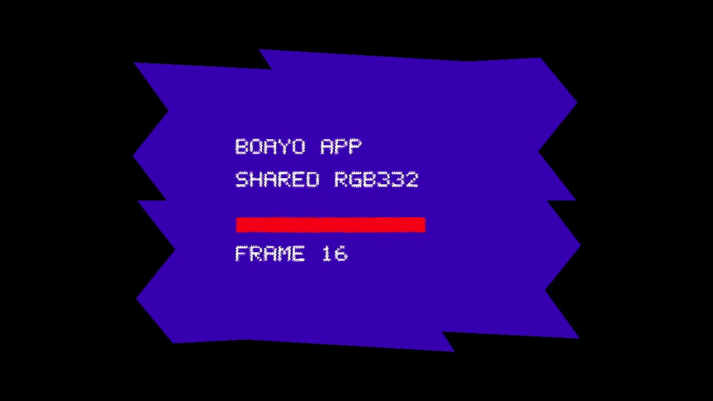

# CPU optimization of the RGB332 triangle WM

This follows the measured [RGB332 comparison](OPTIMIZATION_RESULTS.md). The application binary and FPGA are unchanged; the service changes from `triangle-boayo-v3` to `triangle-boayo-v4`.

## Implementation

- Projection coefficients use Q44 fixed-point arithmetic. Each window still computes its floating-point basis once, normalizes it by a power of two, and converts nine basis coordinates to integers. The per-tile path uses four 32-bit limb products for each signed Q44 multiplication, integer bounds, shifts and rounding. This works on RV32IMA without a compiler 128-bit integer type or an FPU.
- A 1024-Q44-unit coefficient guard and 64-times-larger bound guard preserve reference rounding near half-integers and scale boundaries by falling back to the original descriptor routine. Products and accumulators remain within their documented 64-bit bounds. The host test separately compares 100,000 limb products with a 128-bit arithmetic reference.
- Content planes reject background-only candidate tiles before descriptor generation. Their conservative margins include Q13 vertex/plane quantization and descriptor rounding, including width/height amplification of the far image planes. The triangle background footprint is unchanged. Tests require that no reference-visible tile is rejected.
- Ownership is resolved before planning. A completely covered window defers a new plan until it owns visible tiles again. Its retained source and damage state remain current. A partially visible window still prepares its remaining candidate set; this implementation does not claim arbitrary per-tile occlusion scheduling.
- Sorted contiguous tile plans replace per-tile map nodes and retain capacity. Descriptor batches, DMA copy entries, metadata scratch buffers, visible/touched lists and socket poll entries are reused. Storage grows with actual window footprints instead of reserving 4220 descriptors for every window.
- Integral coordinates in replies are encoded as JSON integers, avoiding soft-float decimal formatting. Fractional coordinates retain double precision. The application call sequence, buffer ownership and presentation acknowledgement semantics are unchanged.

Move-request coalescing, binary IPC, concurrent rendering, direct RGB332 projector input and multiple resident GPU textures are not part of this change. Small-update latency must be measured separately because it already avoided projection-plan rebuilding.

## Verification

The deterministic numerical sweep covers all 4220 tiles at 1024 combinations of pose, FOV and source dimensions, including 1-pixel and 1024-pixel sources and 1-degree/100-degree FOVs. All 4,321,280 descriptors and visibility results match the original implementation. There are 73,506 reference fallbacks (1.70% of this broad sweep); the content filter rejects 3,927,344 candidates without excluding a reference-visible tile. These are numerical sweep counts, not the live scene's fallback rate.

The application tests additionally cover fractional movement while fully hidden, content updates while hidden and correct reconstruction on exposure, along with the existing format, ownership, invalid-request, sparse-damage, resize, overlap and disconnect tests.

ASan/UBSan application tests passed for RGB24, XRGB8888 and RGB332, including the hidden fractional-movement/exposure case. Solid-window and incremental-versus-full-content regression tests also passed; the output-camera check retains its maximum difference of one Q24 unit.

## Physical-board results

2026-11-20, 50 MHz RV32IMA, unchanged FPGA and Linux/BOSIO ABI 3. Each full run completed 45 samples and a 61-point output-pose sweep. Values below are milliseconds; the timed interval includes application buffer copy, IPC and output acknowledgement, and excludes source painting and optical/capture delay.

| Operation | n | v3 median | v4 median | v4 P95/max | Median reduction |
|---|---:|---:|---:|---:|---:|
| Initial content submission | 1 | 2234.982 | 1565.954 | 1565.954 / 1565.954 | 29.9% |
| 8x8 content update | 11 | 563.506 | 511.255 | 720.031 / 720.031 | 9.3% |
| Content window move | 7 | 1520.155 | 908.842 | 991.908 / 991.908 | 40.2% |
| Angular resize | 7 | 1696.900 | 958.269 | 977.825 / 977.825 | 43.5% |
| Three-window overlap move | 5 | 1889.837 | 1228.974 | 1256.581 / 1256.581 | 35.0% |
| Raise | 1 | 973.150 | 867.796 | 867.796 / 867.796 | 10.8% |
| Close | 2 | 611.234 | 514.243 | 595.698 / 595.698 | 15.9% |
| Output pose | 7 | 240.888 | 211.303 | 240.814 / 240.814 | 12.3% |
| Destroy last window | 1 | 490.704 | 452.835 | 452.835 / 452.835 | 7.7% |

Nearest-rank P95 equals max at these small sample counts. Initial/raise/destroy are single observations. In this run every single-window move and resize was below one second, but the maximum movement value of 991.908 ms leaves little margin; this is not a worst-case guarantee. Overlap movement remains above one second.

Movement plan generation fell from 799.365 to 282.864 ms (64.6%); resizing plan generation fell from 946.040 to 287.636 ms (69.6%). Initial content rejects 32 of 72 padded-background candidates before descriptor construction and projects the remaining 40 tiles. These gains reflect the combined arithmetic, filtering and storage changes, not an isolated arithmetic-only experiment.

Overlap movement still uploads 276480 source bytes on the cache-switching samples. Its median projection/upload interval is 424.550 ms, compared with 97.891 ms for single-window movement with zero source upload. Multiple resident source textures would address this remaining cost; the current one-texture cache is unchanged.

Create/map/paint/background preparation took 1550.602 ms before the 1565.954 ms initial-content submission: 3116.556 ms combined from the creation timer, excluding executable startup and initial connection. Do not call the 1.566-second submission value complete startup latency.

The 61-point precomputed output sweep had median 45.083 ms, P95 45.325 ms, maximum 45.400 ms; preparation was 1640.752 ms and total paced sweep 5791.268 ms. Output movement was visually checked through the HDMI capture. The precomputed timing is distinct from the ordinary pose-call timing in the table.

## Reproduction and evidence

- [Raw samples and comparisons](results/cpu-board-20261120.json); [source/binary manifest](results/cpu-build-manifest.json).
- Baseline RGB332 log: `evidence/TRI_8b39cd945d.log`. Optimized log: `evidence/TRI_3918f4ae67.log`; both complete with RC 0.
- Deployment checksum log: `evidence/TRI_2edfe3106c.log`; service start log: `evidence/TRI_4c99e312d1.log`.
- Deployed service SHA256: `0ffa02bf0634a6b1deebaf55e14762cbaf1690c58f591abb94fe150b7402998f`.
- Recording: `evidence/cpu-q44-benchmark.avi`. Capture playback rate is a hint; use `capture-timeline.jsonl` for host timestamps, not optical-latency claims.
- Recorded v4 session, superseded by [v5](TEXTURE_CACHE.md): service `/tmp/triangle-boayo-v4`, unchanged application `/tmp/triangle-app-v3 --rgb332 --demo`; PID files `/tmp/triangle-wm.pid` and `/tmp/triangle-app.pid`. Temporary deployment only; no FPGA flash or boot-service changes.

```sh
/tmp/triangle-app-v3 --rgb332  # finite 45-sample benchmark against the running v4 service
```


