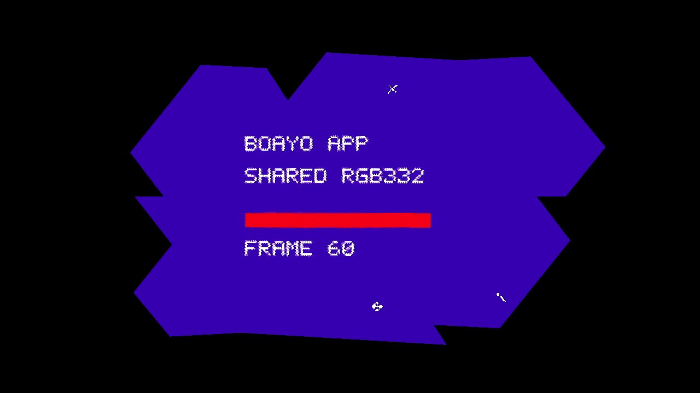
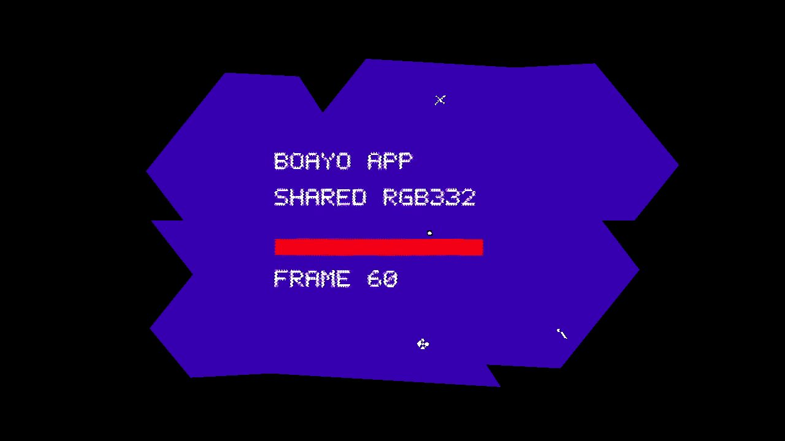

# Button-mask reuse and first RGB332 content (v10)

Measured on 2026-11-21 after v9 (`6fcdce70`). Applications retain the BoAYO API; window silhouettes, controls, and the optional pointer display retain their behavior.

## Changes

- Cache each control tile's normal, hovered and pressed masks. Layout changes clear the masks, including window geometry/ownership, first content and output view changes. A pointer-overlapped tile still uses the combined raster path, preserving dot priority and the coarse-grid fallback.
- Reuse an existing projected-coordinate cache for a button tile, without warming an entire new grid for a static button. For uncached cells, calculate row origins once and increment the three projective coordinates per column; integer coverage and rounding are unchanged.
- Convert a first RGB332 submission directly through the lookup table without comparing old pixels. Unsubmitted pixels retain the initialized background. Later submissions still detect unchanged content.

A preliminary candidate omitted existing-coordinate reuse and regressed move/resize. The final executable and all v10 figures below include that mitigation. Some move/resize regression remains; v10 is a tradeoff, not an improvement in every action.

## Native input latency

Same boot, RAM-backed executables, RGB332 demo paused only after its first update, then renderer drained for two seconds. Both versions use `TRIANGLE_SPARSE_UPLOAD=0`. Each sample runs from the board control request through `wait_present`; UART, browser, HDMI capture and optical latency are excluded. Small sample sets are descriptive, not guarantees.

| Operation | n | v9 median ms | v10 median ms | v10 max ms |
|---|---:|---:|---:|---:|
| Pointer position | 9 | 609.714 | 516.842 | 649.420 |
| Pointer while dragging | 4 | 583.691 | 517.186 | 540.154 |
| Window move on release | 4 | 985.082 | 1055.929 | 1108.421 |
| Resize on release | 4 | 1098.134 | 1129.887 | 1218.980 |
| Output view | 5 | 919.844 | 849.369 | 1049.863 |
| Close on release | 1 | 548.793 | 519.465 | 519.465 |

Pointer median fell by 15.2% and output-view median by 7.7%. Window move median rose by 7.2% and resize by 2.9%; the geometry paths still need work.

## Initial content and active-app input

Three fresh-service runs per version with already-exercised RAM executables: create/map plus first RGB332 content median **4.104 → 3.802 s**. Loading, service startup and deployment are excluded. This is not a cold-boot measurement. The first RAM-backed v9 invocation earlier in this boot took 6.850 s; it is excluded from the repeated-execution comparison rather than compared with warm v10 samples.

With the demo actively updating, nine sequential PC HTTP/UART pointer moves per display mode gave:

| Dot display | Board median / max ms | PC round-trip median / max ms |
|---|---:|---:|
| ON | 888.247 / 1235.386 | 1151.258 / 1400.718 |
| OFF | 444.552 / 972.092 | 649.999 / 1165.887 |

Hidden samples stay away from handles. Hover changes and window movement still require rendering. The real-browser hidden-dot window release took **1232.044 ms** (one contended sample). The two-second initial-display and all-actions-within-one-second goals remain unmet. No optical or 60-fps input-latency claim is made.

## Validation and deployment

- Final host and ASan/UBSan runs match v9 across 160 presented tile-hash states, including first partial RGB332 content, normal/hover/pressed controls, visibility, queued geometry, tile boundaries, overlap and view changes.
- Dot visibility remains independent of coordinate tracking/capture. Hidden movement outside handles skips an unchanged publication; toggles preserve an active capture.
- RGB24, XRGB8888 and RGB332 BoAYO compatibility passes under ASan/UBSan with input disabled.
- All 39 native input samples completed. Actual Edge acceptance passed hidden-dot dragging, display toggling, capture, Escape cancellation and releasing UART. Actual HDMI frames were inspected. With the app paused, four dot-display transitions and 120 captured frames retained all three controls and the title; the app was resumed afterward. These pixel-presence checks do not measure full optical latency.
- Final board SHA256: `f4a533b0471a8d2b18b69c991cad56745e18ad003d0e13f0ff7688886beb18b5`. Persistent file: `/root/triangle-wm-v10/triangle-boayo-v10`; runtime: `/tmp/triangle-boayo-v10`. No boot service was installed.

Live monitor/input: <http://127.0.0.1:8767/>. Refresh the page; **포인터 표시** toggles only the dot. See [INPUT.md](INPUT.md) for launch and API details.

[Native baseline](results/input-v10-before.json), [final native samples](results/input-v10-board.json), [repeated initial content](results/input-v10-initial.json), [live pointer](results/input-v10-live-pointer.json), [browser](results/input-v10-browser.json), [manifest](results/input-v10-manifest.json), [display observations](results/input-v10-display-observations.json).

