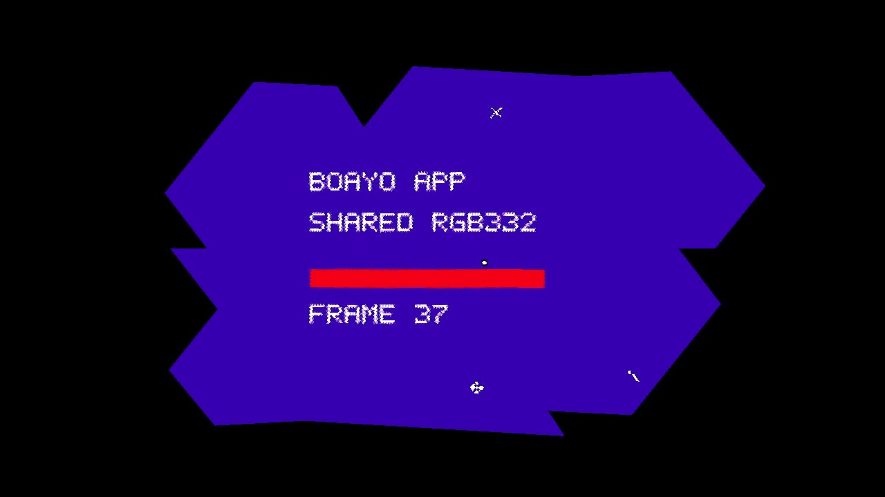

# Pointer CPU optimization and visibility, 2026-11-21

The pointer dot can now be switched off independently of pointer coordinates, button state and capture. The live page exposes **포인터 표시**; **포인터 입력 끄기** remains the separate PC input-transmission control. Hidden motion outside handles does not publish an unchanged frame. Window controls continue to work with the dot hidden. The setting lasts for the running service.

## CPU changes

- Reuse the scene ownership/content plan for pointer-only changes, while retaining any pending app or geometry damage.
- Cache exact projected cell coordinates per tile/output view (4 KiB per visited tile). Native 32-bit division plus exact integer correction replaces repeated software 64-bit division where applicable.
- Use the original sparse calculation for the first frame of a new view, then cache subsequent motion. Pixel coverage and rounding remain unchanged.

## Same-boot board comparison

Both runs used a fresh service, the unchanged RGB332 demo, `TRIANGLE_SPARSE_UPLOAD=0`, and the same persistent native input client. The app was stopped and rendering drained for two seconds. Times cover control request through `wait_present`, excluding UART, capture and optical delay. Small sample counts are functional measurements, not latency guarantees.

| Action | n | v8 median ms | v9 median ms | v9 max ms |
|---|---:|---:|---:|---:|
| Pointer motion | 9 | 749.025 | 619.918 | 757.335 |
| Pointer while dragging | 4 | 713.594 | 578.618 | 619.926 |
| Move on release | 4 | 1156.236 | 1001.030 | 1040.971 |
| Resize on release | 4 | 1247.299 | 1100.701 | 1147.395 |
| Output view | 5 | 872.395 | 920.989 | 1158.933 |
| Close on release | 1 | 547.974 | 541.995 | 541.995 |

Pointer-motion median fell by 17.2%; move and resize medians fell by 13.4% and 11.8%. Output-view median was 5.6% higher in this five-sample run; no view-speed improvement is claimed.

## Initial content and live input

First populated window (one sample per mode, excluding service startup): **3.940 s before / 4.145 s after**. The new total is 2023.474 ms create/map plus 2121.812 ms first content. Initial latency increased in this run and remains above the two-second target.

With the demo updating, nine sequential HTTP/UART moves were measured in each display mode. These are pointer-position updates, not window geometry changes. Hidden samples stayed away from controls; hover changes can still require composition.

| Dot display | Board median / max ms | PC round-trip median / max ms |
|---|---:|---:|
| ON | 1222.024 / 1421.763 | 1418.654 / 1655.349 |
| OFF | 279.340 / 929.091 | 421.869 / 1131.522 |

Actual Edge browser acceptance passed display off/on, dragging with the dot hidden, capture, Escape cancellation and UART restoration. The contended hidden-dot window release took **1784.551 ms** (one sample). Hiding the dot does not eliminate geometry or app/render queuing cost.

The all-actions-within-one-second target is still not met. Capture and optical latency are excluded from all figures above.

## Correctness and deployment

- 105 presented-state hashes match v8, including tile-edge round trips and a queued geometry mutation followed by pointer input. Final ASan/UBSan output matches the same reference.
- Visibility tests cover permission and invalid-value rejection, hidden tracking without publication, preserved capture across toggles and exact pixel restoration.
- One million random and 1,332 boundary quotients match exact division under sanitizers. Existing RGB24/XRGB8888/RGB332 app compatibility also passes with input disabled.
- All 39 native board samples completed; move/resize/close releases applied, and an outside close release canceled. Actual HDMI off/on captures were inspected.
- Final board executable SHA256 matches `e25a67d2a42e84327dd9b9e7fd98468b0a6b17a149e02d74b168d75d71580818`. It is retained at `/root/triangle-wm-v9/triangle-boayo-v9` and running as `/tmp/triangle-boayo-v9`; no boot service was installed.

See [INPUT.md](INPUT.md) for the API and launch procedure. Live input/capture: <http://127.0.0.1:8767/>. Refresh an already open page to load the new checkbox.

[Before samples](results/input-v9-before.json), [final samples](results/input-v9-board.json), [initial content](results/input-v9-initial.json), [live input](results/input-v9-live-pointer.json), [browser verification](results/input-v9-browser.json), [manifest](results/input-v9-manifest.json).

