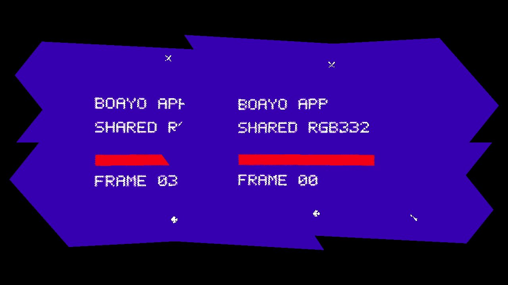
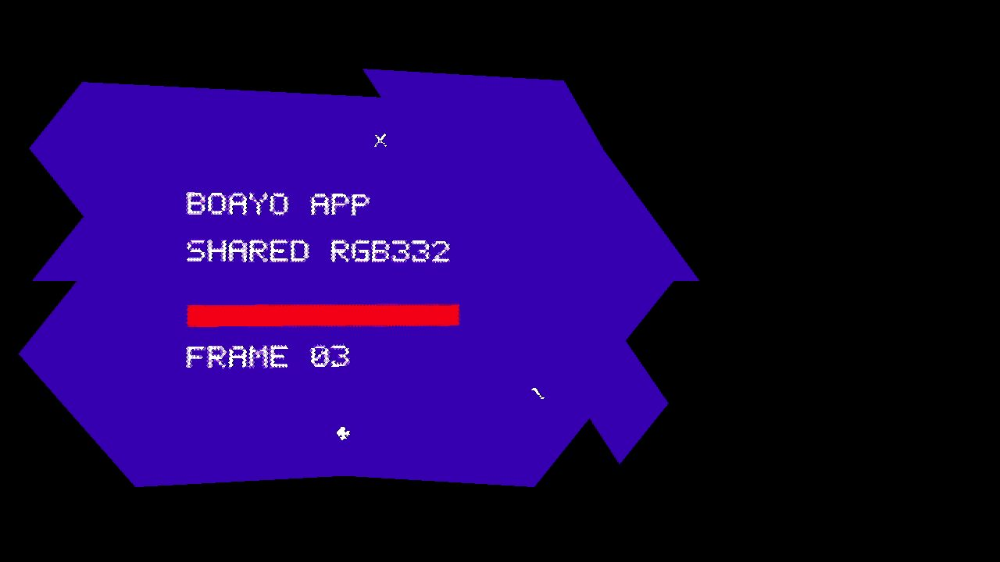
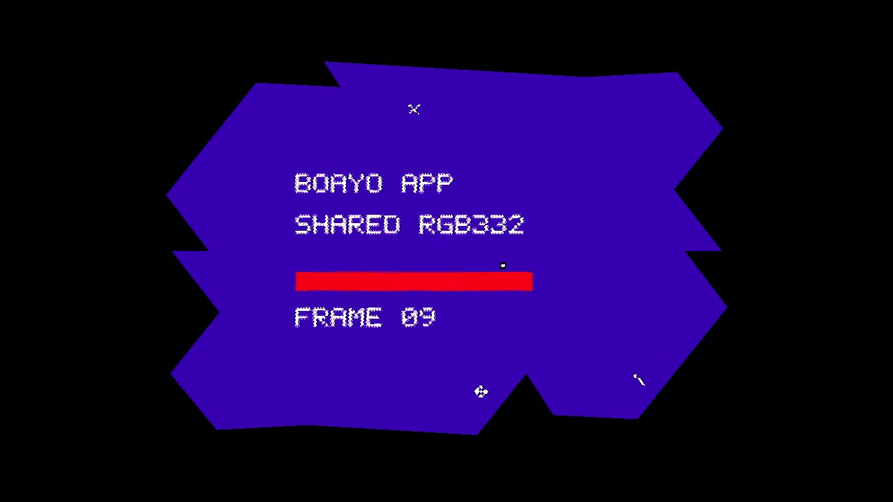

# Split controls and pointer: board results, 2026-11-21

The final integer-cofactor implementation passed all 39 board-local input samples, the two-window overlap/restoration check, and the live browser drag/cancel/stop test. Functional input is available, but the all-actions-within-one-second target is not met. Window move/resize exceed one second, and concurrent application updates add input queuing delay.

## Method

RV32IMA board, BS25 ABI3, native RGB332 application, trim outline, `TRIANGLE_SPARSE_UPLOAD=0`. Final service SHA-256: `f4734c7c5a69412ea135862cfb45f8b63ee4787d90ca7464c66cc5bdeaeda5c7`.

For the following table, one application's process was stopped and the renderer drained for two seconds. A persistent native control client measured request through `wait_present` (view changes are synchronous). UART transport, capture and optical delay are excluded. These are small functional sample sets, not latency guarantees.

| Action | n | Median ms | P95 ms | Max ms |
|---|---:|---:|---:|---:|
| Pointer motion | 9 | 761.733 | 853.517 | 853.517 |
| Pointer while dragging | 4 | 705.937 | 783.043 | 783.043 |
| Move on release | 4 | 1135.181 | 1143.015 | 1143.015 |
| Resize on release | 4 | 1233.434 | 1248.874 | 1248.874 |
| Output view change | 5 | 867.655 | 1050.428 | 1050.428 |
| Close on release | 1 | 530.575 | 530.575 | 530.575 |
| Hide pointer | 1 | 321.682 | 321.682 | 321.682 |

## CPU iteration comparison

Pointer-motion median: first full-tile implementation **1208.483 ms**, bounded floating inverse **900.400 ms**, cached integer inverse **761.733 ms** (37.0% below the first implementation). The first run stopped at the output-view step because the driver requires a separate `BO_SET_POSE` transaction; its pointer samples are retained as an incomplete preflight, not a full passing run.

## Application overhead

Same final binary and same boot; each mode used a fresh service and the unchanged RGB332 application.

| Configuration | 8×8 update median ms (n=11) | Create/map ms (n=1) | First content ms (n=1) | Combined initial ms |
|---|---:|---:|---:|---:|
| Input disabled | 431.447 | 1374.348 | 1450.102 | 2824.450 |
| Input enabled | 469.307 | 2102.880 | 1983.446 | 4086.326 |

The overlay adds **37.860 ms / 8.8%** to the partial-update median. Combined initial time is the sum of create/map and first-content submission; service startup is excluded. A populated first window takes approximately **4.09 seconds**, not two seconds.

## Live contention and browser test

With the demo updating its counter, nine sequential HTTP/UART pointer requests measured:

| Scope | Median ms | Max ms |
|---|---:|---:|
| Board request to publication | 1320.240 | 1647.144 |
| PC HTTP round trip (includes UART and serialization) | 1565.945 | 1897.632 |

The Edge browser test loaded actual HDMI, captured a mouse press, dragged a window, applied on release, canceled a second drag with Escape, and stopped the bridge. The measured contended drag release was **1712.671 ms** (one sample). UART shell access was then verified and the bridge restarted. Capture/optical delay remains outside every timing above.

## Visual and correctness checks

- Controls use owned padding tiles; an occluded lower-window resize handle disappears and returns after the upper window closes.
- Moving the upper window and closing it restored the lower window's full content. Closing the last window and hiding the pointer produced a black HDMI frame.
- Host socket/shared-buffer tests cover invalid input, capture ownership, no trails, updates under the pointer, close cancellation, commit-on-release, disconnect, output view changes, and 36 size/position layouts.
- All 69 presented-state hashes match full-scan rendering, including the final ASan/UBSan build. Compatibility tests cover RGB24, XRGB8888 and RGB332 with input disabled.
- The capture thread survives a transient Windows snapshot-file lock. Frame age is shown by the live input page.

## Reproduction and evidence

See [INPUT.md](INPUT.md) for build, launch, input API and reboot restoration. The final executables are retained under `/root/triangle-wm-v8/`; no boot service was installed. The runtime remains under `/tmp`. The loopback input page is <http://127.0.0.1:8767/> and capture-only monitoring is <http://127.0.0.1:8766/>. The bridge owns COM4 until its stop action completes.

- [Native input samples](results/input-v8-board.json)
- [Same-boot input-off baseline](results/input-v8-no-ui.json), [input-on content samples](results/input-v8-content.json)
- [Live pointer round trips](results/input-v8-live-pointer.json), [browser acceptance](results/input-v8-browser.json)
- [Incomplete first preflight](results/input-v8-preflight.json), [bounded-inverse input run](results/input-v8-bounded-board.json)
- [Build/deployment manifest](results/input-v8-manifest.json)

Local ignored evidence includes `input-v8-integer-bench-console.txt`, `input-v8-multi-status.txt`, `input-v8-multi-move.txt`, `input-v8-multi-restore.txt`, `input-v8-console-restored.txt`, and `input-v8-integer.avi`. Recording frame rate is not an optical latency measurement.
