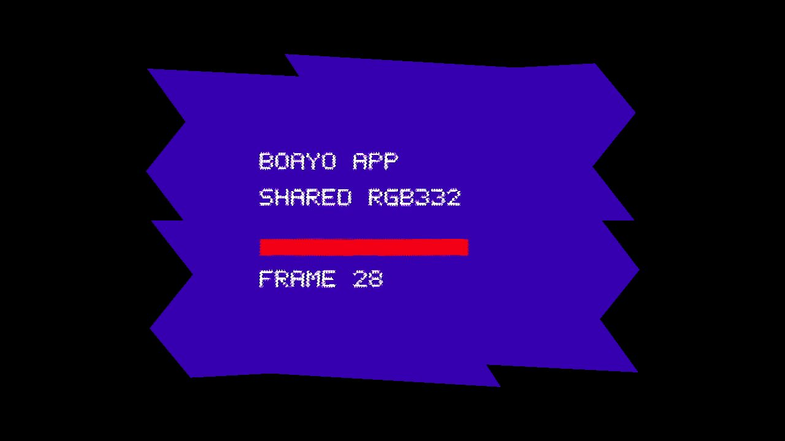

# CPU planning and RGB332: physical-board comparison

2026-11-20, the same 50 MHz RV32IMA board, FPGA image and Linux/BOSIO ABI 3 as [the baseline](BOAYO_RESULTS.md). No FPGA programming or boot installation changes. Source and deployed binary hashes are in [the build manifest](results/optimization-build-manifest.json).

## Results and measurement scope

All values below are milliseconds. Submission latency includes the application-to-shared-slot copy, request processing, rendering and the `wait_present` reply. It excludes source painting and HDMI/capture optical delay. Initial submission is **not complete application startup**: window creation, mapping, painting and initial background presentation occur before it.

| Operation | Original RGB24 | Optimized planning, unchanged RGB24 app | Optimized planning, native RGB332 app |
|---|---:|---:|---:|
| Initial content (one sample per run) | 3104.188 | 2841.126 | 2234.982 |
| 8×8 update, median of 11 | 555.351 | 550.099 | 563.506 |
| Content move, median of 7 | 1684.559 | 1517.841 | 1520.155 |
| Angular resize, median of 7 | 1908.930 | 1707.595 | 1696.900 |
| Three-window overlap move, median of 5 | 2035.956 | 1882.476 | 1889.837 |

RGB332's first submission is 21.3% faster than the optimized RGB24 run; this is a single observed initial sample, not a confidence interval. Small updates and movement have no demonstrated format-related improvement. The separate RGB32 comparison (13 samples, initial/update/destroy only) gave 2850.500 ms initial and 559.864 ms median partial update. Avoiding the RGB24 packing/conversion alone did not produce a material improvement in that comparison.

Create/map/paint/background preparation took 1669.289 ms for RGB24, 1699.790 ms for RGB32, and 1489.111 ms for RGB332. Adding the initial content sample gives 4510.415, 4550.290, and 3724.093 ms respectively from the application's creation timer through initial content acknowledgement; executable startup/initial connection precede this timer.

RGB332 P95/max values were 772.854 ms for partial updates, 1560.309 ms for movement, 1727.041 ms for resizing, and 1894.427 ms for overlap movement. Nearest-rank P95 equals max for these small sample counts. The first partial update copies 36 previously rendered tiles to synchronize the other bank; later repetitions copy zero. Do not present these results as an all-operations-under-one-second guarantee.

RGB332 ordinary output-pose calls had median 240.888 ms and max 258.035 ms. The separate 61-point precomputed pose sweep had median 45.127 ms, P95 45.293 ms and max 45.333 ms per hardware submission. Its preparation took 1681.646 ms and total paced sweep 5827.802 ms. The precomputed result is not arbitrary interactive input latency.

## What changed

- Fixed sphere projection coefficient vectors are generated ahead of time; the runtime constructs a window basis once. Near rounding/scale boundaries it falls back to the reference calculation.
- RGB332 paints text and rectangles directly into 8-bit application pixels, uses 8-bit shared slots, and expands only submitted damage through a 256-entry table into the existing RGB32 cache.
- XRGB8888 is available as a conversion-free comparison path. Legacy clients still default to RGB24 and retain the original application call sequence.

For a 240×144 image, one shared slot is 34560 bytes in RGB332, 103680 in RGB24, or 138240 in XRGB8888. Persistent WM storage including both slots and its private source is 6/10/12 bytes per pixel. Current projector input remains RGB32: initial GPU upload is 138240 bytes and an 8-row partial upload is 7680 bytes in all formats. RGB332 does not reduce those uploads with the current RTL.

## Remaining CPU work and recommended order

1. Replace per-tile software double arithmetic in `fast_descriptor` with range-checked fixed-point multiply/accumulate and integer normalization. This is the largest measured opportunity: RGB332 planning is 799.365 ms for movement and 946.040 ms for resize. Keep reference fallbacks where rounding cannot be proven equivalent; validate descriptors and output tiles before deploying. RV32 has no FPU; switching from double to float would still require software floating point.
2. Exclude background-only and fully occluded tiles before expensive descriptor construction. The initial scene checks 72 padded-background candidates but projects only 40 content tiles. Use conservative content bounds and actual tile ownership, preserving edge coverage and rebuilding newly exposed tiles. Already-precomputed sphere vectors do not eliminate these per-window calculations.
3. Reuse contiguous planning/descriptor/job buffers instead of allocating map nodes and vectors during each render. Bound memory for up to 64 windows; do not allocate a full large descriptor array per window blindly. Profile this separately from arithmetic before assigning a latency saving.
4. Split CPU accounting for footprint construction, JSON parsing/serialization, allocation, response construction and presentation waiting. Current movement acceptance is 386.418 ms, but that includes footprint calculation and cannot all be attributed to JSON. After measuring, keep the application API while simplifying internal representation and allowing compact presentation calls. Preserve slot-release, generation and completion semantics.
5. Coalesce pending move requests to the latest state and separate output-pose scheduling from scene rebuilding. This reduces queued-input lag, not the latency of a single required render. CPU threading on a single core does not make the arithmetic faster.

If movement planning alone fell from 0.80 to 0.25 seconds, holding the rest of the measured path constant would put 1.52-second movement near 0.97 seconds. This is a budget calculation, not an achieved result. Small updates already have zero planning time and need work on fixed request/publication overhead instead. Multiple source textures in DDR could also remove overlap reuploads, but that is a separate device-memory/driver design task.

## Verification and evidence

- 1,350,400 host descriptor/visibility comparisons against the original implementation: zero differences, 5,521 guarded fallbacks. All 256 palette colors matched between native 8-bit and 32-bit painters.
- ASan/UBSan API tests passed for RGB24, XRGB8888 and RGB332, including mixed-format overlap, invalid requests, slot reuse and full-render comparisons. The unchanged C++ client completed 45 host mock samples per format. Original solid/content/camera checks also passed.
- Physical RGB24 and RGB332 runs each completed 45 samples plus 61-point pose sweeps; RGB32 completed its 13-sample format comparison. HDMI captures showed RGB332 text, partial updates, resizing, overlapping windows and output-pose movement.
- [Machine-readable comparison with raw samples](results/optimization-board-20261120.json).
- UART logs: `evidence/TRI_b0eac543d6.log` (RGB24), `evidence/TRI_025a017228.log` (RGB32), `evidence/TRI_8b39cd945d.log` (RGB332); all end in RC 0. Deployment SHA verification: `TRI_05ec99b44f.log`, `TRI_09426c3822.log`.
- Recordings: `evidence/optimization-rgb24.avi`, `optimization-rgb32.avi`, `optimization-rgb332.avi`. The recording frame rate is a playback hint; use `capture-timeline.jsonl` for capture timing, not optical latency.
- Recorded v3 demo session (superseded by [the CPU-optimized v4 session](CPU_OPTIMIZATION.md)): `/tmp/triangle-boayo-v3` PID 270 and `/tmp/triangle-app-v3 --rgb332 --demo` PID 286, with PID files as documented in [BOAYO.md](BOAYO.md). Live launch transcript: `evidence/TRI_961f31bded.log`. Temporary deployment only.

