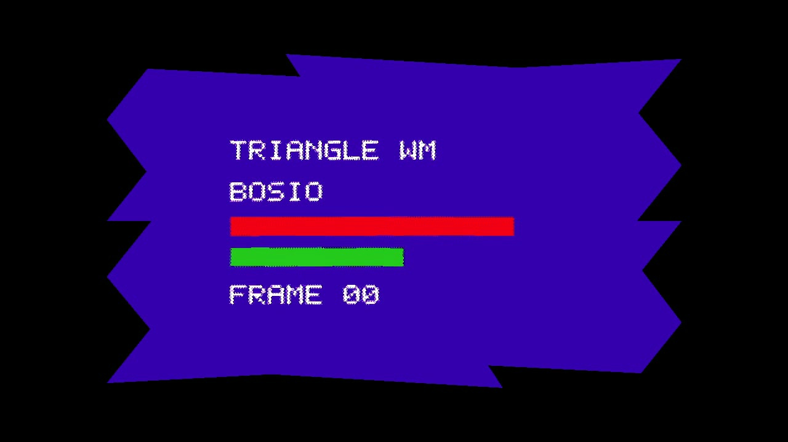
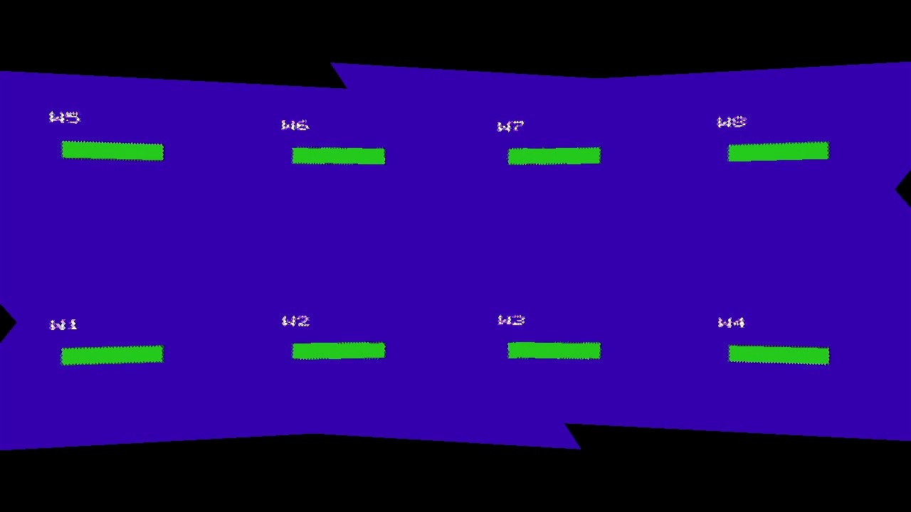

# 삼각 타일 WM 실보드 결과 — 2026-11-20

6단계를 실제 보드에서 실행하고 USB3.0 Video의 HDMI 캡처로 확인했다. 아래 표는 최종 최적화 실행 파일의 결과다. 이전 중간판과 원시 표본은 `results/board-20261120.json`에 함께 보존한다.

실시간 모니터: http://127.0.0.1:8766 (테스트 호스트에서 서비스가 실행 중인 동안).

## 지연시간 (ms)

| 단계 / 동작 | 표본 수 | 중앙값 | P95 | 최대 |
|---|---:|---:|---:|---:|
| 1단계 / 최초 생성 (1회) | 1 | 421.590 | 421.590 | 421.590 |
| 1단계 / 창 표시 | 21 | 283.605 | 309.877 | 313.559 |
| 1단계 / 출력 시점 | 61 | 45.668 | 45.845 | 52.279 |
| 2단계 / 창 이동 | 21 | 419.140 | 434.244 | 441.189 |
| 2단계 / 출력 시점 | 61 | 45.659 | 45.847 | 51.965 |
| 3단계 / 여러 창 이동 | 21 | 378.108 | 403.426 | 404.904 |
| 3단계 / 순서·닫기 (2회) | 2 | 278.002 | 282.918 | 282.918 |
| 3단계 / 출력 시점 | 61 | 47.799 | 48.874 | 49.894 |
| 4단계 / 정적 콘텐츠 배치 (3회) | 3 | 2438.512 | 2518.395 | 2518.395 |
| 4단계 / 출력 시점 | 61 | 45.963 | 51.503 | 52.706 |
| 5단계 / 텍스트 부분 갱신 | 21 | 431.908 | 451.590 | 673.881 |
| 5단계 / 막대 부분 갱신 | 21 | 320.301 | 350.657 | 369.696 |
| 5단계 / 출력 시점 | 61 | 46.054 | 46.255 | 52.750 |
| 6단계 / 1개 창 중 1개 이동 | 11 | 344.678 | 354.767 | 354.767 |
| 6단계 / 4개 창 중 1개 이동 | 11 | 340.525 | 359.588 | 359.588 |
| 6단계 / 8개 창 중 1개 이동 | 11 | 334.371 | 352.612 | 352.612 |
| 6단계 / 16개 창 중 1개 이동 | 11 | 349.909 | 356.694 | 356.694 |
| 6단계 / 32개 창 중 1개 이동 | 11 | 370.105 | 380.441 | 380.441 |
| 6단계 / 8x8 콘텐츠 갱신 | 11 | 300.550 | 314.372 | 314.372 |
| 6단계 / 60x30 콘텐츠 갱신 | 11 | 409.908 | 424.501 | 424.501 |
| 6단계 / 200x90 콘텐츠 갱신 | 11 | 679.285 | 684.866 | 684.866 |
| 6단계 / 콘텐츠 창 1개 순환 갱신 | 24 | 280.549 | 280.871 | 297.578 |
| 6단계 / 콘텐츠 창 4개 순환 갱신 | 24 | 380.636 | 411.165 | 415.721 |
| 6단계 / 콘텐츠 창 8개 순환 갱신 | 24 | 332.965 | 366.473 | 368.412 |
| 6단계 / 시점 입력부터 완료 응답 | 21 | 107.303 | 131.999 | 136.366 |
| 6단계 / 출력 시점 | 61 | 45.996 | 46.143 | 46.157 |

측정 범위: C 클라이언트의 요청 송신 시작부터 WM의 출력 완료 응답 수신까지. 소켓 연결 설정, 클라이언트 요청 파일 읽기, UART 출력은 제외한다. WM의 파싱·준비·투영·게시·응답 직렬화는 포함한다. P95는 정렬 표본의 ceil(0.95×N)번째 값이다. 1~3회 측정값은 통계적 꼬리 지연 추정으로 해석하지 않는다.

출력 시점 행은 미리 준비한 카메라를 적용하는 호출 시간이다. ioctl 완료 및 호출부 처리 비용을 포함하며 사전 좌표 계산과 16.667ms 간격 대기는 제외한다. 실제 광학 지연이 아니다. 모든 단계에서 시점 이동 전후 장면 commit 수가 동일했다. 캡처 카드의 60fps는 WM 갱신율을 의미하지 않는다.

## 콘텐츠 준비와 부분 갱신

| 단계 | 시점 61개 좌표 준비 (ms) |
|---|---:|
| 1 | 1666.595 |
| 2 | 1663.670 |
| 3 | 1677.244 |
| 4 | 1692.766 |
| 5 | 1679.145 |
| 6 | 1639.476 |

| 5단계 동작 | 중간판 중앙값 | 최종 중앙값 | 감소 | 재투영 타일 중앙값 | 원본 전송 바이트 중앙값 |
|---|---:|---:|---:|---:|---:|
| 5단계 / 텍스트 부분 갱신 | 717.330 | 431.908 | 39.8% | 6 | 13440 |
| 5단계 / 막대 부분 갱신 | 618.760 | 320.301 | 48.2% | 6 | 13440 |

최초 콘텐츠 구성은 원본 생성·좌표 디스크립터 계산·원본 전체 업로드·투영을 포함한다. 부분 갱신은 디스크립터와 원본을 재사용한다. 다른 버퍼에 아직 없는 변경되지 않은 타일은 DMA로 복사하므로 초기 동기화 표본이 최댓값에 포함될 수 있다. 원본 업로드는 변경 영역을 포함하는 전체 행 범위이며 최소 픽셀 바이트 수와 같지 않다.

## 규모 시험의 해석

6단계 단색 창은 12×9도, 2단계 창은 20×14도로 규격이 다르다. 32개 창을 매번 모두 이동한 값이 아니라 **32개 중 1개**를 이동한 값이다. 콘텐츠 순환 갱신도 매 요청마다 창 하나의 컴포넌트를 수정한다.

| 변경 영역 | 재투영 타일 중앙값 | 원본 전송 바이트 중앙값 |
|---|---:|---:|
| 8×8 | 4 | 7,680 |
| 60×30 | 10 | 28,800 |
| 200×90 | 41 | 86,400 |

콘텐츠 창 4개와 8개는 배치가 달라 변경 타일 중앙값이 각각 8개와 4개다. 따라서 8개 조건의 시간이 더 짧다고 창 수 증가 자체가 성능을 높인다고 해석하면 안 된다. 현재 투영 입력 DDR 영역은 최근 원본 하나를 캐시하므로 서로 다른 창으로 넘어가면 그 원본을 다시 업로드한다. 여러 원본의 DDR 상주는 후속 개선 항목이다.

## 화면 검증과 범위

- 단색 창 외곽은 삼각 타일의 합집합이며 내부·외부 장식 테두리가 없다.
- 창 이동, 중첩 순서 변경, 닫기 뒤 아래 창 복원을 실제 캡처로 확인했다.
- 글자·막대 배치, 글자/막대 갱신, 겹친 컴포넌트 삭제 뒤 복원을 확인했다.
- 호스트 참조 검사에서는 부분 갱신의 모든 타일 픽셀이 독립적인 전체 재생성과 일치했다. 하드웨어 화면 전체의 픽셀 단위 참조 대조와 광학 지연 측정은 수행하지 않았다.
- 별도로 4·5단계 최종 정지 화면의 중간판/최적화판 HDMI JPEG를 비교했고, 두 경우 모두 픽셀 차이가 0이었다. 전체 동영상 프레임에 대한 동일성 검사는 아니다.
- 화면의 글자 가장자리 품질은 기존 삼각 셀 해상도와 RGB332 양자화의 영향을 받는다.
- 최종 코드는 로컬 `/tmp/triangle-wm-v3`에서 실행한다. 기존 SD 부팅 WM은 교체하지 않았다. 기존 BoAYO 앱 프로토콜·입력 라우팅·세션 수명주기 호환은 별도 통합 작업이다.
- 현재 메타데이터 게시 ABI의 전체 검증/전송 비용과 콘텐츠 위치 변경 시 디스크립터 계산 비용은 남아 있다.
- 요청 처리는 직렬이며 콘텐츠 합성 중 새 시점 요청을 선점하는 구조는 아니다. 이번 시점 이동 검증은 각 단계의 장면 작업 뒤 별도 수행했다. 60fps의 상호작용이나 동시 드래그·시점 이동 성능을 달성했다고 주장하지 않는다.

최종 RV32 SHA256: `a5d379e5e7711537f55fd8d5588e9c53b602942cf00ad05fb69376f85e9b3340`

재현: `README.md`의 빌드·검증·단계 실행 절차를 따른다. 원시 UART 로그, AVI, 개별 캡처는 로컬 `evidence/`에 있다.
