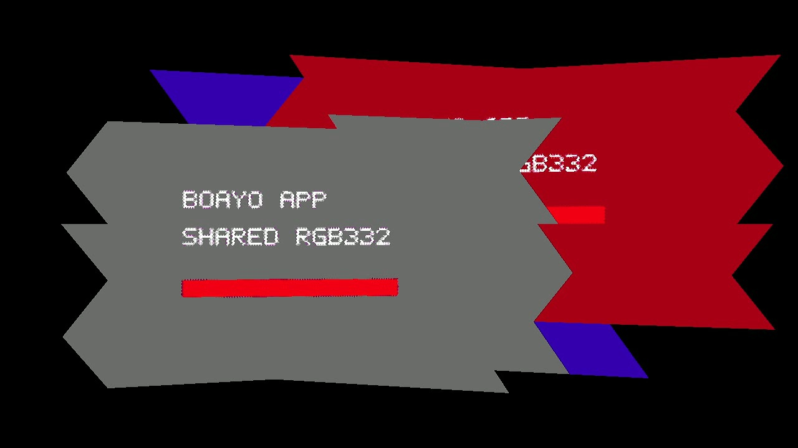
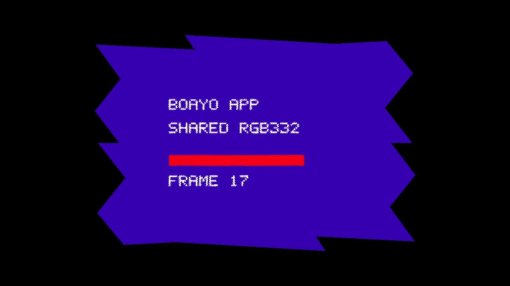

# Resident textures and shared window transforms

This follows the [Q44 CPU optimization](CPU_OPTIMIZATION.md). Service v5 retains the same FPGA, driver ABI and application v3 binary. It uses the existing descriptor source-word offset, BO_TEXTURE region, scratch region and ordered DMA copy batches.

## Implementation

- A first-fit allocator keeps each source in the existing 4 MiB DDR texture arena. A descriptor's word 0 selects that window's source offset; `texture_words` bounds the addressed allocation. A resident, unchanged source needs no upload when the window moves or another window is rendered.
- Each entry tracks source size, revision, validity and last use. If no contiguous allocation fits, least-recently-used entries are evicted until one does. Eviction happens between synchronous projector runs, never while a core is sampling. An evicted source is fully restored from retained CPU pixels before it is used again. Close/disconnect releases its entry; a source replacement invalidates it even if its size happens to match.
- Dirty source rectangles remain pending while hidden. A resident source receives its accumulated changes before projection; a nonresident source receives a complete upload. The allocator changes source storage, not displayed scene-bank ownership.
- Window axes are shared between footprint calculation and projection planning. Content and padded FOV tangents are cached independently and recomputed only when their inputs change. Source dimensions are applied when constructing the projection. Exact numerical tests compare the cached fields with the original constructor.
- Small narrow updates can be packed into one reusable CPU buffer, uploaded once to BO_SCRATCH, then scattered to the correct source rows by one ordered BO_BATCH. This path is limited to at most 32 rows, less than half the source width, and scratch capacity. Other updates retain a contiguous full-width-row upload. `TRIANGLE_SPARSE_UPLOAD=0` selects the contiguous path for an on-board comparison.

`texture_upload_bytes` counts CPU-to-DDR source/staging bytes. `texture_scatter_bytes` separately counts scratch-to-texture DMA bytes; neither includes descriptor/scene-metadata traffic. `resident_textures` and `texture_evictions` expose cache behavior. A packed 8x8 update uploads 256 bytes and scatters 256 bytes, compared with the previous 7680-byte source upload at source width 240.

## Verification

- 10,000 randomized allocation/resize/release operations plus an explicit LRU test: all allocations remain in bounds and disjoint.
- 4,321,280 exact descriptor/visibility comparisons against the original geometry; cached axes and FOV values match exactly. Existing indexed-painter and integer-multiply checks remain enabled.
- ASan/UBSan application tests passed for RGB24, XRGB8888 and RGB332. They check partial rendering against full reconstruction, three simultaneous sources at different offsets, zero warm-cache uploads, sparse DMA writes, hidden updates, fractional movement, source ownership and disconnect cleanup.
- RGB332 tests with a 64 KiB mock arena force eviction and verify subsequent reconstruction. `TRIANGLE_TEXTURE_WORDS` is a mock-only test capacity override; hardware always uses the existing 4 MiB arena.
- The contiguous-upload comparison path, original solid/content regression tests and output-camera check passed. Maximum camera-reference difference remains one Q24 unit.

## Physical measurement

2026-11-20, the same 50 MHz RV32IMA board, FPGA image and Linux/BOSIO ABI 3. Both v5 modes completed 45 samples and 61-point output sweeps using the unchanged RGB332 app v3.

The selected v5 configuration was **`TRIANGLE_SPARSE_UPLOAD=0`** (retained by the subsequent [v6 service](RESPONSE_PATH.md)): resident textures and shared transforms are enabled, while source damage uses contiguous rows. The binary supports the packed path (and enables it when no override is supplied), so use the explicit launch setting below to reproduce the selected latency profile.

| Operation | n | v4 median ms | v5 selected median ms | v5 P95 / max ms |
|---|---:|---:|---:|---:|
| Initial content submission | 1 | 1565.954 | 1602.246 | 1602.246 / 1602.246 |
| 8x8 content update | 11 | 511.255 | 519.021 | 748.434 / 748.434 |
| Content window move | 7 | 908.842 | 890.743 | 946.713 / 946.713 |
| Angular resize | 7 | 958.269 | 961.407 | 980.613 / 980.613 |
| Three-window overlap move | 5 | 1228.974 | 930.100 | 948.448 / 948.448 |
| Raise | 1 | 867.796 | 696.296 | 696.296 / 696.296 |
| Close | 2 | 514.243 | 528.316 | 586.656 / 586.656 |
| Output pose | 7 | 211.303 | 228.678 | 243.768 / 243.768 |
| Destroy last window | 1 | 452.835 | 451.280 | 451.280 / 451.280 |

The interval includes application copy into the shared slot, IPC, rendering and the output acknowledgement. It excludes source painting and optical/capture latency. Repeated operations use medians; initial/raise/destroy are single observations. Nearest-rank P95 equals max at these small sample counts. These observations do not establish a worst-case bound.

**Main improvement:** overlap movement is 24.3% faster and raising a window is 19.8% faster. All five overlap samples retain three resident sources, perform zero texture evictions and upload zero source bytes. The previous overlap median uploaded 276480 bytes. Its upload/projection interval falls from 424.550 to 112.136 ms. Both v5 modes show the same elimination of texture reuploads.

Single-window movement, resize and small-update latency remain broadly similar to v4. Shared-transform caching reduces some setup work, but it does not justify a large end-to-end speedup claim. It also moves initial content-transform preparation into window setup, so compare complete operation timing rather than planning time alone.

### Packed versus contiguous source updates

| 8x8 update | Packed staging + DMA rows | Contiguous source rows |
|---|---:|---:|
| CPU-to-DDR source bytes | 256 | 7680 |
| Additional scratch-to-texture DMA bytes | 256 | 0 |
| End-to-end median ms | 530.826 | 519.021 |
| Upload/projection median ms | 57.963 | 42.911 |
| P95/max ms | 741.053 | 748.434 |

Packing reduces source upload bytes by 96.7%, but its per-row DMA work raises the median upload/projection cost in this 240-pixel-wide workload. The live configuration therefore keeps contiguous uploads. The first partial sample also synchronizes 36 scene tiles between banks; its max latency is distinct from steady repeated updates. The packed option remains available for other workload measurements, with no claim that it is universally slower or faster.

Create/map/paint/background setup took 1544.275 ms, followed by 1602.246 ms for initial content: 3146.521 ms combined from the creation timer (executable startup/initial connection excluded). Initial startup did not meaningfully improve. The 61-point precomputed pose results and all individual samples are retained in the JSON report; the ordinary pose-call timing is in the table.

## Reproduce and inspect

```sh
export BOAYO_SOCKET=/tmp/bosio-wm.sock
TRIANGLE_SPARSE_UPLOAD=0 /tmp/triangle-boayo-v5 > /tmp/triangle-boayo-v5-rows.log 2>&1 &
/tmp/triangle-app-v3 --rgb332          # finite benchmark
# Or run the persistent demo instead:
/tmp/triangle-app-v3 --rgb332 --demo
```

Only one service may own the device. Stop the existing service before starting another. No FPGA programming, kernel changes or boot-service installation were performed.

- [Machine-readable comparison and raw samples](results/texture-board-20261120.json); [source/binary manifest](results/texture-build-manifest.json).
- Packed run: `evidence/TRI_6406b397b8.log`; selected contiguous run: `evidence/TRI_b71ce3da56.log`. Both complete with RC 0.
- Deployment SHA verification: `evidence/TRI_12a631065e.log`. Start logs: `TRI_e10d651509.log` (packed) and `TRI_84c9389335.log` (contiguous).
- Service SHA256: `54fcca3b19d0ba2f1f7c4c392527ac97df8ae9a4c090af5dbdbb9f6679f5477f`.
- Recordings: `evidence/texture-cache-packed.avi` and `texture-cache-rows.avi`. Use the capture timeline for host frame timing; the AVI playback-rate hint is not an optical-latency measurement.




