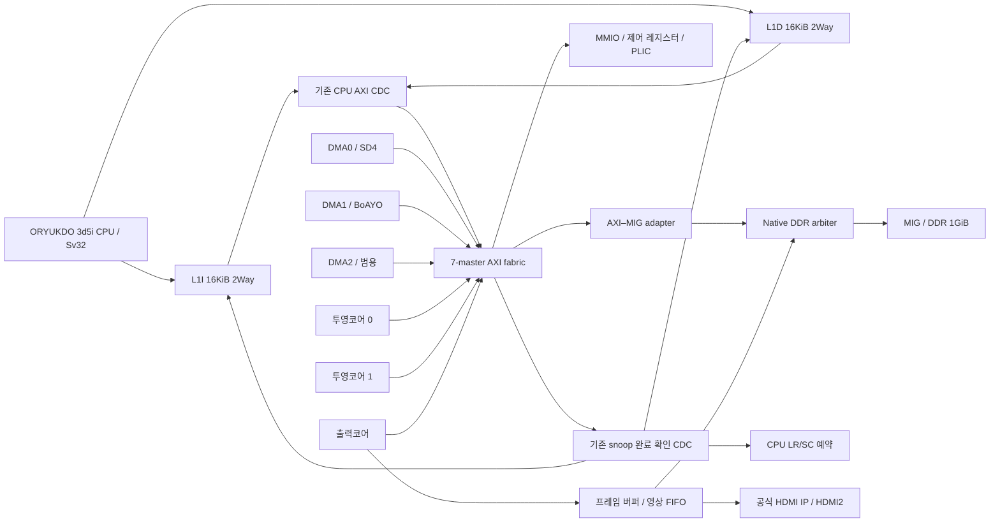

> **HDMI IP 준비:** 이 구성도 [공통 외부 다운로드 방식](../../docs/외부_HDMI.md)을 사용한다. 저장소 루트에서 `python scripts/prepare_current_hdmi.py --all` 실행 후 빌드한다. IP 본문은 Git에 포함하지 않는다.

# 해반천 — L1 16KiB × 2 / DMA 3개 구성

기준은 보존된 `variants/sd4-dma`와 BoAYO `updates/boayo-tiles-v5`다. 이 초기 16KiB 후보는 RTL 44건과 합성을 통과했으나 배선 후 Setup을 통과하지 못했다. 캐시 면적과 실제 위반한 출력 제어 신호를 보완한 [최종 구성](../l1-16k-dma3-lru-ram/README.md)은 전체 배선·비트스트림 생성을 통과했다. 이 폴더는 수정 전 비교본으로 보존한다. `provenance/baseline_sd4_dma`는 기존 보드 결과이며 이 후보의 PASS 증거가 아니다.

사용자가 면적 여유를 우선해 I/D 각각 16KiB로 변경한 구성이다. 선행 32KiB RTL과 결과는 `variants/l1-32k-dma3` 및 별도 실행 폴더에 보존했다. 32KiB 보드 구현은 사용자 선택에 따라 배선 전에 중단했으므로 배선 후 타이밍 통과 결과가 없다. 이 폴더의 `provenance/reference_32k`도 비교 자료이며 16KiB 검증 증거가 아니다.

캐시는 물리 주소 변환 뒤에 위치한다. CPU issue 구성과 스케줄러는 유지한다. 캐시 가능한 RAM의 읽기만 line refill을 사용하며, MMIO와 BOSIO 예약 영역은 기존 단일 전송 경로로 우회한다.

## CPU 캐시

- L1I 16KiB, L1D 16KiB, 각각 2-way / 256 sets / 32-byte line / LRU.
- 물리 주소로 인덱스와 태그를 결정한다. 서로 다른 가상 주소가 같은 물리 메모리를 가리켜도 별도 사본을 만들지 않는다.
- D-cache는 write-through / no-write-allocate다. CPU Store 응답은 DDR 경로의 쓰기 응답 이후에만 반환한다. dirty line이나 write-back 버퍼는 없다.
- I/D 응답은 독립적이다. Fetch 응답 소비가 막혀도 이전 Load를 수행할 수 있다.
- CPU Store는 해당 D-cache 및 I-cache 라인을 무효화한다. `FENCE.I`는 순서가 보장된 완료 시점에 I-cache를 전체 무효화하고 기존 복구 경로로 먼저 가져온 명령을 버린다. 무효화 이전에 시작한 refill이 라인을 되살리지 못하게 한다.
- 일반 RAM만 캐시한다. MMIO, BOSIO 예약 영역 `0xbd000000..0xbdffffff`, 출력 프레임 영역 `0xbf800000..0xbfffffff`는 캐시하지 않는다.
- 캐시 데이터 배열을 초기화하지 않고 valid bit와 교체 상태를 리셋한다. 실제 payload는 BRAM으로 구현한다.

## CPU와 DMA의 데이터 일치

CPU 쓰기는 DDR까지 반영한 뒤 완료되므로 DMA Read가 dirty CPU cache를 놓치지 않는다. DMA Write는 기존 fabric의 주소 통지를 통해 CPU의 I/D 라인과 LR/SC 예약을 무효화한다. 기존 AMD XPM 완료 확인 경로가 CPU의 무효화 소비를 확인한 뒤 DDR 쓰기를 허용한다. 이 경로는 기존 BOSIO 세 AXI master, SD DMA, 새 DMA 두 개에 모두 적용된다. 원자적 연산 동안은 기존 전역 잠금으로 외부 DMA를 배제한다.

일반 RAM의 DMA 일치는 하드웨어가 보장하므로 Linux DT에서 해당 장치를 `dma-coherent`로 선언한다. 기존 `dma_map_sg`, `dma_unmap_sg`, `dma_wmb`, `dma_rmb` 및 버퍼 수명 관리는 유지한다. 캐시 일치가 작업 소유권이나 요청 순서를 대신하지 않는다. CPU와 장치가 동시에 같은 버퍼를 수정하도록 허용하는 변경이 아니다.

보드 영상 프레임 저장·스캔은 AXI fabric을 우회해 native DDR arbiter를 사용한다. 이 경로의 프레임 버퍼는 CPU가 항상 캐시하지 않는 상위 8MiB에만 있으므로 snoop 누락으로 캐시 사본이 남지 않는다. 전원 인가 시 SD 부트로더의 직접 DDR 쓰기는 CPU와 캐시 reset 해제 전에 끝난다.

근거: [RISC-V FENCE.I](https://docs.riscv.org/reference/isa/unpriv/zifencei.html), [Linux DMA API](https://docs.kernel.org/core-api/dma-api-howto.html).

## DMA와 인터럽트

| 엔진 | MMIO | PLIC source | 용도 |
|---|---|---:|---|
| 기존 DMA0 | 0x10009000 | 2 | SD 내부 전송 및 기존 copy/fill |
| 추가 DMA1 | 0x1000a000 | 3 | BoAYO/BOSIO의 Linux memory DMA 채널 |
| 추가 DMA2 | 0x1000b000 | 4 | 범용 CPU 제어 / Linux DMAengine 채널 |

SD 인터럽트는 기존 source 1을 유지한다. 세 엔진은 각자의 요청·상태·완료 IRQ를 갖는다. Copy/Fill, 4KiB 경계 분할, RAM 범위 검사, 오류 완료 기능은 기존 DMA RTL을 재사용한다. 새로운 두 엔진의 SD 전용 포트는 비활성화한다. 기존 Linux DMAengine 드라이버가 세 장치를 각각 등록한다. BoAYO는 DMA1을 사용하며, DMA2를 BoAYO가 자동 병렬 사용하는 기능까지 추가한 것은 아니다.

DDR fabric은 기존 방식대로 AXI transaction 단위로 중재한다. 독립 엔진 세 개를 동시에 대기·실행시킬 수 있지만 DDR 대역폭이 세 배가 되지는 않는다. DMA2도 주소와 IRQ가 연결된 실제 엔진이며 테스트에서 세 엔진의 busy가 동시에 유지되는 구간을 검증한다.

## 보드 구성과 재현

PZ-A7200T-KFB / `xc7a200tfbg484-2`, DDR 1GiB, MIG, HDMI2, SD4, UART·SPI·I2C와 기존 BOSIO 코어를 유지한다. CPU 50MHz(20ns), fabric 100MHz, 영상 74.25MHz 제약을 완화하지 않는다. MIG 설정 파일과 HDMI IP 내부 소스는 기준본 그대로다.

WSL Ubuntu에서 `software/storage/test_all_l1.sh`가 캐시·저장장치·CPU·Sv32·실제 BOSIO 코어 회귀를 실행하고 44개 증거 로그를 수집한다. `software/storage/build_l1_image.sh`는 v5의 BusyBox·BoAYO·자료를 보존하고 새 DT와 Linux 식별자를 넣은 SD 이미지를 만든다. Linux/BoAYO QEMU 시험과 이미지 감사는 RTL 시험과 별도로 기록한다.

Vivado는 `soc/board/build_mig.tcl`, `build_area_medium_synth.tcl`, `route_guarded.tcl` 순서다. 기준 보드와 같은 면적 최적화 합성과, 실제로 입력 레지스터가 풀렸던 DSP에 한정한 보호 설정을 사용한다. 각 실행 폴더와 원본 로그를 분리한다. 배선 후 Setup/Hold와 CDC·DRC를 확인하기 전에는 타이밍 PASS나 사용 가능한 새 비트스트림이라고 판단하지 않는다.

배선 혼잡 비교안은 같은 합성 체크포인트에 `prepare_rs_mux.tcl` → `place_only.tcl` → `route_from_placed.tcl`을 적용한다. RS FIFO 한 곳의 MUXF 1,536개만 LUT로 재매핑하며, RTL과 레지스터 단계는 같다. `place_only.tcl`의 PASS는 배치 완료만 뜻한다. 최종 수집기 `collect_board.py`는 실제 배선 완료, Setup/Hold, DRC/CDC, 소스 및 MIG 해시와 비트스트림을 확인한다. 비교안을 수집할 때에는 네 번째 인자로 실제 입력인 `placed_optimized.dcp`를 전달해 합성 체크포인트와 배선 입력을 구분한다.

## 검증 범위

L1 단독 검증은 전체 용량, 2-way/LRU, 부분 Store, 무효화/refill 충돌, 독립 응답, 오류 및 무작위 접근을 포함한다. 실제 CPU 통합 검증은 self-modifying code와 FENCE.I, AMO, 캐시된 DMA 목적지, 세 엔진 동시 동작, 각각의 IRQ, SD 읽기/쓰기, M/S 인터럽트를 포함한다. 실제 AXI–MIG adapter와 native arbiter를 사용한 mock DDR 시험에서는 상위 1GiB 주소 범위도 확인한다.

QEMU의 Linux·BoAYO 시험은 SD 안의 소프트웨어를 검증하며, 이 CPU 캐시나 실제 DMA RTL을 검증하는 실행은 아니다. 물리 보드에서 새 비트스트림과 SD를 함께 실행하는 시험은 별도다.
